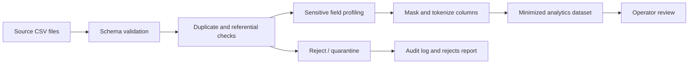

# Pipeline architecture

## Notes

- Validation happens before masking so malformed records never reach the published dataset.
- The same deterministic hashing strategy is used for reruns, which keeps tokenization stable.
- The reject report contains source metadata and failure reasons for traceability.
